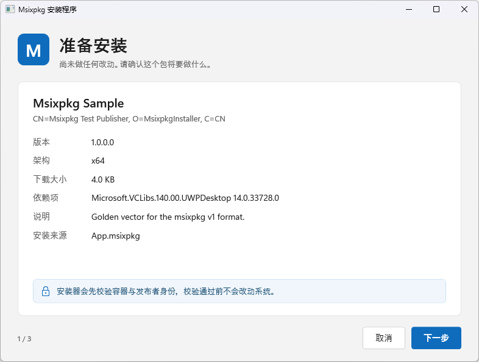
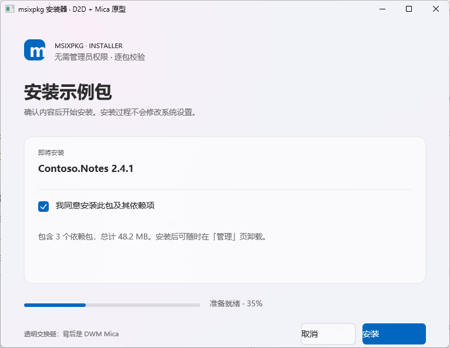
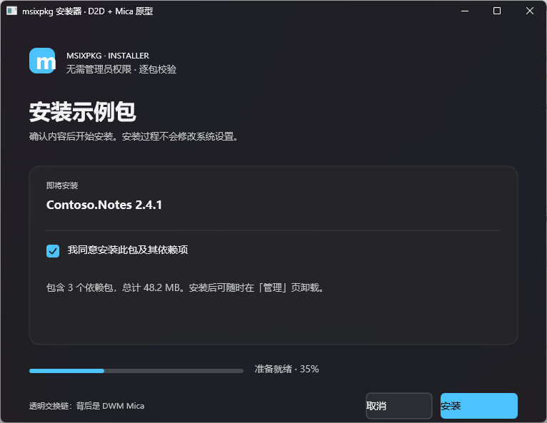
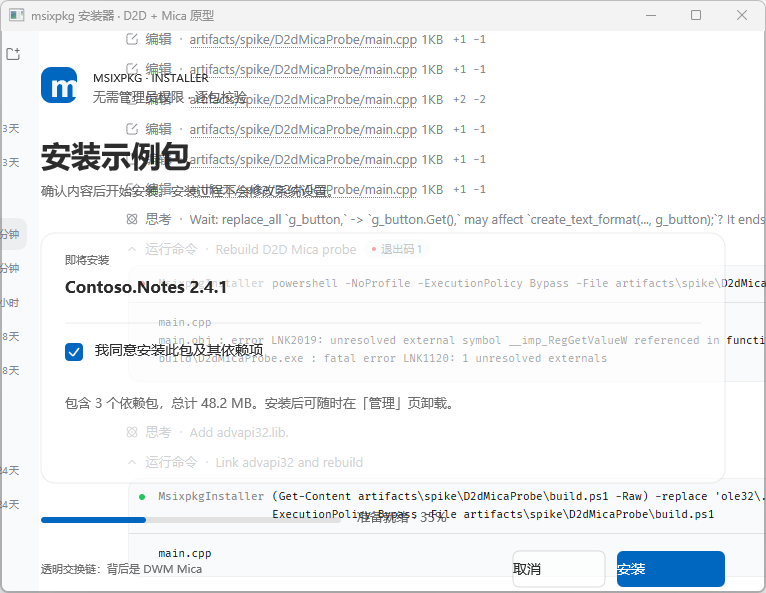
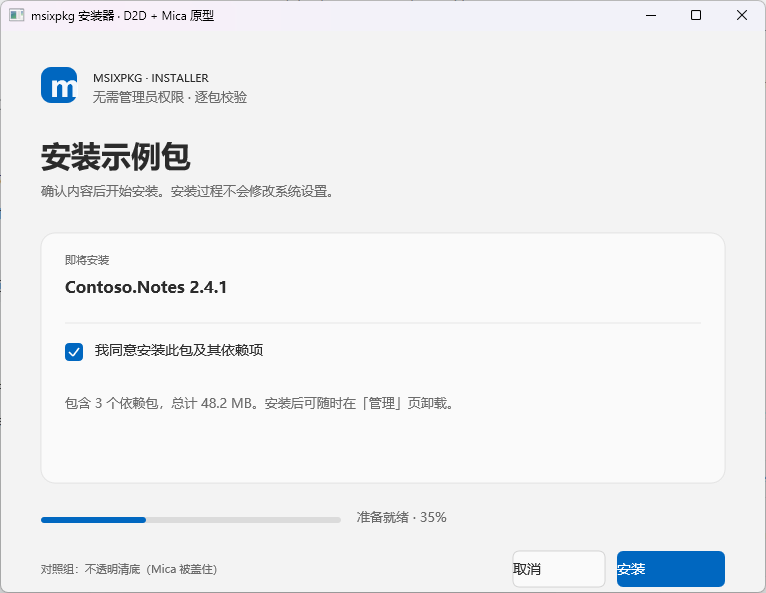

# 安装器 UI 改用 WPF 的可行性评估

> 评估对象：`src/MsixpkgInstaller.Native/gui`（Win32 五页向导）
> 评估时间：2026-10-27
> 结论先行：**技术上可行，WPF 的美观上限明显高于现在的 Win32 标准控件；但按这个仓库当前的约束，不建议为了“更好看”把安装器整体迁到 WPF。** 如果确定要 WPF，唯一务实的组合是 **.NET Framework 4.8 的 WPF UI + 保留现有原生引擎**（约 4–6 周）；**.NET 10 自包含 WPF（约 60–140 MB）不适合这个安装器**。
> 追加（2026-10-27）：D2D + DirectComposition 路线见 **§10**。结论：**能拿到 DWM 真 Mica、零 .NET 运行时，但必须全自绘；混合标准控件实测不可行，工作量 6–10 周，且 Mica 只在 Win11 22H2+ 可用。**
> 全自绘（GDI+ widget 框架 + Mica/Acrylic/Solid）的落地设计见 [`docs/self-drawn-ui-framework.md`](self-drawn-ui-framework.md)。

---

## 1. 现在的 UI 是什么样

### 1.1 技术栈

| 项 | 现状 |
|---|---|
| 语言/框架 | C++20，纯 Win32 + `comctl32` v6 + `dwmapi` |
| 窗口 | `WS_OVERLAPPED` 标准边框，720×480 dp，`PerMonitorV2` |
| 控件 | 标准 `STATIC` / `BUTTON` / `EDIT` / `PROGRESS_CLASS` / `WC_LISTVIEW` |
| 主题 | `DWMWA_USE_IMMERSIVE_DARK_MODE` + Mica（`DWMWA_SYSTEMBACKDROP_TYPE` + `DWMWA_REDIRECTIONBITMAP_ALPHA` + GDI+ 透明清底）；圆角通过 DWM 请求 |
| 字体 | Segoe UI，15 pt 标题 / 9 pt 正文 |
| 页面 | SUMMARY / CONSENT / PROGRESS / RESULT / MANAGE |
| 代码量 | GUI 约 2,400 行 C++（`gui_wizard.cpp` 1,524、`gui_worker.cpp` 573、`gui_ui.cpp` 194、`gui_strings.cpp` 136） |

架构上有一处对“换 UI”很有利：`gui_ui.h` 只定义纯数据结构，`gui_worker.cpp` 是唯一接触 `Installer` / `StateStore` / 部署栈的编译单元，引擎侧还有 `IProgressSink` / `IConsentProvider` / `ICancelSource` 三个前端契约。也就是说，**UI 与安全/部署逻辑本来就是分开的**，换 UI 不需要重写证书、校验、状态库。

### 1.2 视觉基线

现有截图（`artifacts/gui/v2-summary.png`、`v2-consent-armed.png`）能看出问题不在“布局”，而在**控件外观不是自己的**：

- 按钮是 Win32 默认的直角灰底按钮，复选框/进度条/列表都是系统默认样式；
- 没有卡片、圆角、强调色、图标体系、过渡动画；
- ~~页面背景是纯色，`DWMWA_SYSTEMBACKDROP_TYPE=Mica` 虽然请求了，但 `WM_ERASEBKGND` 用不透明画刷填满客户区，**Mica 实际上被盖住了**~~ —— 同日已修好（`apply_backdrop`：
  `DWMWA_REDIRECTIONBITMAP_ALPHA` + GDI+ `SourceCopy` 清成 alpha=0 + 扩展边框；Win11 26100+ 生效，其余系统仍回退纯色）。实测窗口激活时背景是材质，失焦时 DWM 自动换成 `SolidBackgroundFillColorBase` 纯色兜底；
- 深色/浅色只靠 `WM_CTLCOLOR*` 换两个颜色，标题栏和内容区还可能不一致（截图里就能看到标题栏深、内容区浅的组合）。

这不是实现水平问题，而是**标准 Win32 控件的“可定制天花板”就这么高**。要再往上走，只有两条路：自己 owner-draw（等于手写一个小型 UI 框架，还要自己补 UIA），或者换一个有模板/样式系统的 UI 框架。

### 1.3 体积与依赖（实测）

| 产物 | 大小 |
|---|---|
| `msixpkg-installer.exe`（Release） | 817,664 B（约 0.8 MB） |
| `MsixpkgInstaller-0.3.0-setup.exe` | 589,701 B（约 0.58 MB） |
| 便携包里的 `msixpkg-installer.exe` | 约 1.0 MB（旧版本产物） |

用 `dumpbin /dependents` 看，当前 GUI **并不是严格的“零依赖”**：

```
COMCTL32.dll  dwmapi.dll  GDIPLUS.dll  bcrypt.dll  CRYPT32.dll  SHELL32.dll
MSVCP140.dll  VCRUNTIME140.dll  VCRUNTIME140_1.dll  ...
```

> `GDIPLUS.dll` 是 Mica 那一版实现引入的：DWM 只在重定向位图带 alpha 时才让材质透出来，
> 而普通 GDI 填充改不动 alpha 通道，只有 GDI+ 的 `SourceCopy` 能把它清成 0。它和
> COMCTL32/dwmapi 一样是系统自带组件，不增加分发体积。

也就是说，它已经依赖 VC++ 2015–2022 运行库（`/MD`），只是这个运行库通常随其他软件或系统镜像存在。**这一点降低了“WPF 会引入运行时依赖”的独特性**，但没有改变“.NET 运行时比 VC++ CRT 大得多”的事实。

---

## 2. WPF 能带来什么

### 2.1 能力对照

| 能力 | 现在 Win32 | WPF（net48） | WPF（net9/10） |
|---|---|---|---|
| 按钮/复选框/进度条的完全自定义 | owner-draw，自己实现状态与 UIA | `ControlTemplate`，保留 `ButtonAutomationPeer` | 同左 |
| 圆角卡片、阴影、矢量图标 | GDI/D2D 手绘 | 原生支持 | 同左 |
| 动画/过渡 | 手写 timer/D2D | `Storyboard`/`VisualState` | 同左 |
| 深色/浅色/高对比 | 手写画刷 + 系统色 | 手写 `ResourceDictionary` | Fluent `ThemeMode` + 手写 HC |
| 系统强调色 | 自己读注册表/DWM | 自己读 | .NET 9+ 内置 `SystemColors.AccentColor*` |
| Mica/亚克力 | 自绘材质（壁纸缩略图 + 着色；DWM 材质被 GDI 客户区盖住） | 无透明交换链，`WindowChrome`/layered window 下 DWM 材质不可靠，通常只能自绘或 acrylic | 同左；WPF 不内置 Mica |
| Per-monitor DPI | 已做 PerMonitorV2 | .NET Framework 4.8 支持 PerMonitorV2 + mixed-mode | 支持 |
| UIA/键盘导航 | 标准控件免费获得 | 标准控件/模板保留 automation peer | 同左 |
| 本地化 | `.rc` 字符串表 | `.resx` + BAML/附属程序集 | 同左 |
| 启动/内存 | 低 | 中 | 中高 |

### 2.2 原型（spike）

为了不只停留在纸面判断，本次做了一个单页原型（`artifacts/spike/WpfProbeNet48`，未入库），把 SUMMARY 页按 Fluent 风格重画：

| WPF net48（手写模板，系统内运行时） | WPF net10（Fluent theme，框架依赖） |
|---|---|
|  |  |

- 同一套布局/样式 XAML（net48 版本去掉 `ThemeMode`）在 **net48** 和 **net10** 下都能跑；右图是 net10 版本（启用了 WPF Fluent theme，`ThemeMode="Light"`），左图是 net48 版本（没有 Fluent theme，按钮/卡片全部手写模板），视觉上几乎一致。
- 单页样式 + 布局约 250 行 XAML；五页按同样密度估算 **1,000–1,500 行 XAML + 一套主题资源**，不是“天文数字”，但也绝不是改几行样式。
- **结论：WPF 的“美观”不是免费的，来自模板、间距、字体、颜色、图标这些设计工作；WPF 只是把这些工作变得可维护。**

### 2.3 关键取舍：Fluent theme 只在 .NET 9+

- WPF 在 **.NET 9** 才引入 Fluent 主题：`ThemeMode="Light|Dark|System"`、系统强调色、Win11 风格控件模板（见 [What's new in WPF for .NET 9](https://learn.microsoft.com/en-us/dotnet/desktop/wpf/whats-new/net90)）。
- **.NET Framework 4.8 没有 Fluent 主题**，默认仍是 Aero2。想要现代观感，必须自己写模板/主题资源（本次 spike 就是这么做的），或引入第三方主题库。
- 因此存在一个硬取舍：
  - **选 net48**：运行时在系统内、体积小；但“漂亮”要自己写。
  - **选 net10**：Fluent theme 开箱即用；但 .NET 10 运行时不在系统内，自包含要 60 MB+。
- 想把 .NET 9 的 Fluent XAML 直接搬到 net48 不现实：它依赖 `ThemeMode`、强调色等新增 API。

---

## 3. 实测数据

Spike 环境：Windows 11 build 26300，x64，100% DPI；.NET Framework 4.8.1（release 534296）；.NET SDK 10.0.401；Release 构建，取 10 次“进程启动 → 主窗口句柄出现”的中位数。

| 指标 | 原生 Win32（现有 GUI） | WPF net48（spike） | WPF net10（spike，框架依赖） |
|---|---|---|---|
| 可执行文件 | 818 KB | 13 KB（单页 mock） | 159 KB apphost + 12.5 KB dll |
| 运行时 | Windows + VC++ CRT | .NET Framework 4.8（Win10 1903+/Win11 通常自带） | .NET 10 Desktop Runtime（不在系统内） |
| 窗口出现（中位） | **76 ms** | **259 ms** | **462 ms** |
| 工作集 | **17.3 MB** | **71.1 MB** | **101.3 MB** |
| 自包含发布 | — | — | **139.6 MB / 400 文件**；single-file 压缩后 **58.3 MB** + 约 8 MB 原生 DLL |

说明：

- Spike 只有一页，真实五页应用会更大；上表的体积只用于量级判断，不是最终预算。
- 冷启动（干净机器、杀毒软件扫描、无 NGEN）会明显高于上表；net48 的 NGEN 镜像可能帮忙，但首次运行仍要留余量。
- 启动差距是**百毫秒级**，对一次性安装器不算致命；内存从 17 MB 涨到 70–100 MB，是更明显的代价。
- 当前这台机器上，net48 的 WPF 应用能正常构建和运行；`net48` 的 WPF 4.8 支持 PerMonitorV2 与 mixed-mode DPI（见 [.NET Framework 4.8 的 High DPI 说明](https://learn.microsoft.com/en-us/dotnet/framework/whats-new/#v48)）。

### 3.1 .NET 10 自包含到底多大

`dotnet publish -c Release -r win-x64 --self-contained true`：

- 普通发布：**139.6 MB，400 个文件**；
- `PublishSingleFile=true` + 压缩：主 exe **58.3 MB**，另有 `wpfgfx_cor3.dll`、`PresentationNative_cor3.dll`、`D3DCompiler_47_cor3.dll` 等约 8 MB 原生依赖，合计 **约 66 MB**；
- WPF **不支持 trimming / NativeAOT**，所以这个体积基本没有压缩空间。

对比现在的 setup 约 **0.58 MB**，这是两个数量级。

### 3.2 .NET Framework 的可用性

- Windows 10 1903+ 与 Windows 11 通常自带 .NET Framework 4.8（Win11 是 4.8.1）。
- Windows 10 1809 / LTSC 2019 自带的是 4.7.2；如果要支持这些系统，net48 就需要额外安装 .NET 4.8，或者降到 net472（但 4.7.2 **没有** PerMonitorV2，会牺牲 DPI 体验）。
- 因此 net48 WPF 的“运行时门槛”不是零，但比 .NET 10 低得多。

### 3.3 顺带验证：net48 能不能直接调部署 API

能。用 net48 控制台引用 Windows SDK 的 `Windows.winmd`，成功实例化 `Windows.Management.Deployment.PackageManager`，并检测到 `AddPackageByUriAsync` 存在。也就是说，**“完全用 C# 重写安装器”在技术上是可能的**——但这是另一条更危险的路，见 §5。

---

## 4. 真正的成本在哪里

如果只看“WPF 能不能画得漂亮”，答案是能。真正决定值不值的是下面六件事：

### 4.1 引擎互操作

原生引擎（容器校验、证书存储、部署栈、状态库、回滚、策略）约 5,800 行 C++，有 72 条原生测试，并且和 C# 侧做过逐字节摘要对照。**不应该为了换 UI 把它重写成 C#**。

WPF UI 要驱动它，只有三种接法：

| 接法 | 做法 | 优点 | 缺点 |
|---|---|---|---|
| **原生 DLL + C ABI + P/Invoke**（推荐） | 把 `msixpkg_core` 编成 DLL，导出 `install/uninstall/preview/list/...` 和进度/同意/取消回调 | 边界清晰、引擎逻辑零改动、可单测 | 要写 C ABI 门面与封送，约 400–800 行 |
| C++/CLI 包装 | 用 `/clr` 直接包 C++ 接口 | 胶水代码最少 | `/clr` + C++20 + C++/WinRT 的编译风险；mixed-mode DLL；锁死 .NET Framework |
| 独立进程 + JSON 协议 | WPF 调 `msixpkg-native.exe`，读 JSON/JSONL | 隔离最好 | 当前 CLI 没有进度事件/同意回调协议；新增协议是安全敏感面，工作量也不小 |

**不建议**：把证书信任、钉扎判断、回滚这些逻辑搬到 C#。当前原生侧已经把“界面显示的正文”和“安装时据以决策的内容”做成同一份数据（`PackageView`/`ConsentRequest`），这个性质很值钱。

### 4.2 行为等价清单

换 UI 不是重画五页，而是把这些行为原样搬过去：

- 命令行：`install [path]`、`--manage`、`uninstall --family-name/--install-id`、CLI 专属子命令 exit 3；
- 单实例：`Global\` 互斥体 + `FindWindow` + `WM_COPYDATA`（带超时、忙时拒绝）；
- 拖放：`.msixpkg` 拖入 → 载入 → 跳同意页；
- 提权：助手必须是同目录的 `msixpkg-native.exe`（`runas` + `SW_HIDE`）；GUI 自己当助手会三方互等死锁（handoff 坑 19）；
- ARP：`UninstallString` 指向 GUI 的 `uninstall --family-name`；
- 文件关联/快捷方式/便携包/setup 载荷；
- 退出码 0–7 与 CLI 逐字一致；
- 同意页安全门（未勾选禁用、未钉扎二次确认、`--all-users` 条件显示）；
- UIA 名称、Tab 顺序、回车默认按钮、屏幕阅读器；
- 深色/浅色/高对比、PerMonitorV2、zh-CN/en-US；
- 被 `SW_HIDE` 拉起时不能弹 MessageBox、不能闪控制台。

这些每一条都有现成测试或踩坑记录，WPF 版本要重新过一遍。

### 4.3 运行时与体积

- net48：运行时在系统内，UI 自身只增加几百 KB 到 1–2 MB；但老系统（1809/LTSC 2019）要装 4.8。
- net10 自包含：+60–140 MB，和“一个 0.6 MB 的安装器”定位冲突。
- net10 框架依赖：要求用户先有 .NET 10 Desktop Runtime，必须配 bootstrapper/联网安装，复杂度与失败面都上一个台阶。
- 便携包/Windows Sandbox/被安全软件拦住的机器：文件越多、体积越大，越容易触发“未签名 exe 被拦/写不了 TEMP”的问题。

### 4.4 构建、CI 与分发

- 现在是 CMake 一套工具链；加 WPF 就变成 CMake + .NET 双工具链。
- CI 要装 .NET Framework 4.8 targeting pack（windows-latest 通常有）或 .NET 10 SDK；`dotnet build` 与 CMake 的产物要一起塞进 setup。
- setup 的“文件是否真的写下去”检查、锁定文件检查、便携 zip、PATH/关联/ARP 都要跟着改。
- 代码签名流程不变，但多签一个 exe/dll。

### 4.5 安全、无障碍、DPI

- 安全：同意页是信任决策面。把 .NET 运行时加载进这个进程会增加攻击面；引擎留在 native 可以缓解，但“UI 进程越小越好”这个性质会变弱。
- 无障碍：WPF 标准控件有 UIA peer；自定义 `ControlTemplate` 只要还是 `Button`/`CheckBox`，peer 仍在。但必须用 Accessibility Insights/Narrator 实测；现有 UIA 客户端把 Win32 控件统一报成 `Pane`（handoff 第 8 条），WPF 可能更好，也可能暴露新问题。
- DPI：net48 4.8 支持 PerMonitorV2，但 WPF 在多显示器混合 DPI 下仍有已知毛边；必须在 150%/200% 双屏实测，不能只看 100%。
- 主题：net48 没有 Fluent theme，深色/浅色/高对比/强调色都要自己维护；这是一笔持续成本。

---

## 5. 方案矩阵

| 方案 | 运行时 | 体积增量 | 美观上限 | 工作量 | 风险 | 建议 |
|---|---|---|---|---|---|---|
| **A. 保留 Win32，做视觉刷新** | 不变 | ~0 | 中高（受标准控件限制） | 1–3 周 | 低–中 | **首选（如果目标是“更好看”）** |
| **B. WPF net48 + 原生引擎** | .NET Framework 4.8（系统内） | +0.5–2 MB | 高 | 4–6 周 | 中–高 | **确定要 WPF 时选它** |
| C. WPF net10 自包含 | 自带 .NET 10 | +60–140 MB | 高（Fluent） | 5–8 周 | 高 | 不建议 |
| D. WPF net10 框架依赖 | 需装 Desktop Runtime 10 | 小 | 高（Fluent） | 5–8 周 + bootstrapper | 很高 | 不建议 |
| E. 完全用 C# 重写引擎 | net48/net10 | 小–中 | 高 | 8–12 周 | 很高（安全/回归） | 不建议 |
| F. WinUI 3 | Windows App SDK（自带或自包含） | +40–100 MB | 最高（原生 Win11） | 6–10 周 | 高（打包/提权） | 暂不建议 |
| **G. D2D + DirectComposition（全自绘）** | 无 | +0.1–0.8 MB | 最高（Win11 22H2+ 真 Mica） | 6–10 周 | 高（自建 UI/UIA/测试） | 仅当真 Mica 是硬需求且 Win11-only，见 §10 |

> “美观上限”不是“默认就好看”。net48 WPF 的默认 Aero2 和现在的 Win32 差不多朴素；上面的“高”指的是**有模板/样式系统可以做到**，代价是设计工作。

---

## 6. 如果目标是“更好看”：优先做 A（原生视觉刷新）

这条路不换运行时、不动引擎、不重写测试，1–3 周可以把观感提升一大截。按收益排序：

1. ~~**让 Mica 真正可见**：`WM_ERASEBKGND` 不要用不透明画刷填满；用 DWM backdrop + 透明/半透明背景，Win10 回退纯色。~~ ✅ 2026-10-27 已做：`DWMWA_SYSTEMBACKDROP_TYPE` + `DWMWA_REDIRECTIONBITMAP_ALPHA`（26100+）+ `DwmExtendFrameIntoClientArea(-1)`，客户区用 GDI+ `SourceCopy` 清成 alpha=0，静态文本空心画刷 + 透明背景；其余系统仍走纯色。
2. **自定义标题栏**（可选）：`DwmExtendFrameIntoClientArea` + 自绘标题/图标，保留系统 caption 按钮；Win11 可用 `DWMWA_CAPTION_COLOR`/`DWMWA_TEXT_COLOR` 先做轻量版。
3. **字体与排版**：Segoe UI Variable（Win11）/ Segoe UI（Win10），建立 28/20/14/12 的字号层级、4/8 dp 间距、行高与最大行宽。
4. **强调色主按钮**：`BS_OWNERDRAW` 圆角按钮，带 hover/pressed/disabled/focus 状态；保留 UIA name/role。
5. **卡片/分区背景**：用 GDI+ 或 D2D 画圆角卡片 + 1px 描边，放在静态文本后面；交互控件仍用标准类。
6. **图标体系**：Segoe Fluent Icons（Win11）/ Segoe MDL2 Assets（Win10），给阶段、状态、警告配图标。
7. **进度条**：owner-draw 圆角强调色进度条；阶段列表用带图标的只读列表（保留可聚焦/可复制）。
8. **主题令牌**：Light/Dark/High Contrast 三套颜色；跟随系统强调色；尊重“减少动画”。
9. **响应式布局**：最小宽度、文本换行、长发布者 DN/路径省略与 ToolTip。
10. **保留标准控件**：`EDIT`/`CHECKBOX`/`LISTVIEW` 不要全部自绘；它们是无障碍和键盘导航的免费来源。

验收：150%/200% DPI、深浅色、高对比、Narrator/Accessibility Insights、现有 UIA 名称不变、负例 E2E 不变。

---

## 7. 如果确定要 WPF：走 B（net48 + 原生引擎）

### 7.1 目标架构

```
msixpkg-installer.exe  (WPF, net48, asInvoker, 只有 UI)
        │  P/Invoke
        ▼
msixpkg-core.dll       (现有 C++ 引擎 + C ABI 门面，证书/部署/状态/回滚不变)
        ▲
        │  runas + SW_HIDE（仅证书助手）
msixpkg-native.exe     (CLI，现有提权助手与自动化入口)
```

- UI 进程只负责展示、收集同意、发取消；信任数据的计算与钉扎/策略判断仍在 native，UI 回传的用户决定也要由 native 再校验一次。
- 提权助手继续是 `msixpkg-native.exe`（同目录），不要改成 WPF exe。
- ARP/文件关联仍指向 `msixpkg-installer.exe`，参数解析与退出码在 WPF 启动器里复刻。

### 7.2 C ABI 门面建议

最小集合（按现有 GUI 实际用到的能力）：

```
int  msixpkg_preview(const wchar_t* container, PackageViewNative* out, ErrorNative* err);
int  msixpkg_install(const wchar_t* container, const InstallOptionsNative* opts,
                     ProgressCallback progress, ConsentCallback consent, CancelFlag* cancel,
                     InstallResultNative* out, ErrorNative* err);
int  msixpkg_uninstall(...);   // family-name / install-id
int  msixpkg_list(...);        // 管理页
int  msixpkg_verify(...);      // 修复建议
void msixpkg_free(...);
```

注意：

- 回调线程与 UI 线程的封送（WPF `Dispatcher`）；
- 字符串用 UTF-16，长度显式传递；
- 错误码/错误消息与 CLI 的 `E_*` 保持一致；
- 同意的 `approved/remember_publisher/all_users` 必须由 native 再校验一次，不能只信 UI；
- 取消用 `std::atomic<bool>` 或事件句柄，保持现有语义。

### 7.3 分阶段

| 阶段 | 内容 | 出口条件 | 预估 |
|---|---|---|---|
| 0. Spike | net48 WPF 壳 + 5 页假数据 + 自定义 chrome + 深浅色 + UIA + DPI；P/Invoke 打通 `preview` | 能跑、能量体积/启动/UIA | 3–5 天 |
| 1. 互操作 | C ABI 门面 + P/Invoke + 回调 + 错误映射 | `preview/install/uninstall/list` 与 CLI 行为一致 | 1–2 周 |
| 2. UI | 5 页 + MVVM + 主题资源 + 自定义模板 + 图标 + 动画 | 设计稿验收 + 键盘/屏幕阅读器 | 2–3 周 |
| 3. 打包 | setup 载荷、关联、ARP、便携包、签名、CI | 安装/卸载 E2E 45 项 + 负例 33 项 | 1 周 |
| 4. 回归 | 63 原生测试不变；UIA/DPI/深浅色/高对比；Win10 22H2 + Win11 干净 VM | 全绿 | 1 周 |

总计约 **4–6 周**（不含视觉设计探索）。如果还要把 net10/Fluent 作为目标，再加 1–2 周打包/运行时工作，并接受 60 MB+。

### 7.4 验收门槛（建议写进 PR 模板）

- 安装载荷总大小 ≤ 当前的 2 倍（不含 .NET Framework 本身）；单文件 UI ≤ 2 MB。
- 参考机 warm 启动 ≤ 500 ms、工作集 ≤ 120 MB；干净 VM 首次启动 ≤ 2 s（记录基线，不作为硬门槛）。
- 72 条原生测试、132 条托管测试、33 项负例 E2E、45 项 setup E2E 与 90 项 setup GUI 烟测全绿。
- 150%/200% DPI、双屏混合 DPI、Light/Dark/High Contrast、zh-CN/en-US 全部人工过一遍。
- UIA：五个页面的关键控件名称/角色/可用状态与现在一致；Tab 顺序完整；Narrator 能读完同意页。
- 不提权也能完成“预览 + 同意 + 安装（用户级）”；提权助手仍是 CLI；退出码 0–7 不变。
- 干净 Win10 22H2 / Win11 虚拟机各跑一次完整安装/卸载闭环。

---

## 8. 明确不建议的路线

1. **.NET 10 自包含 WPF**：体积 60–140 MB，与安装器定位冲突；WPF 不支持 trimming/NativeAOT，压不下去。
2. **.NET 10 框架依赖**：要求用户预装 Desktop Runtime 10；必须做 bootstrapper，失败面大。
3. **完全用 C# 重写引擎**：证书存储、部署栈、回滚、钉扎、状态库都要重做；现有 72 条原生测试和跨语言逐字节校验的价值会归零。
4. **在 Win32 窗口里嵌 WPF island**：airspace、DPI、焦点、UIA 混合问题会让它比现在更糟。
5. **为了五页向导上 WinUI 3**：Windows App SDK 运行时/自包含体积、unpackaged 提权与生命周期问题，收益不匹配。

---

## 9. 最终建议

```
目标是“更好看”，且不想动分发/运行时？
  → A：原生视觉刷新（1–3 周，ROI 最高）

目标是“安装器要长期演进成管理面”（多包、更新历史、设置、日志），
且团队愿意维护 C++ + C#/XAML 双栈？
  → B：WPF net48 + 原生引擎（4–6 周）

必须用 Fluent theme / .NET 10 新特性，且能接受 60 MB+ 或运行时安装？
  → 重新评估产品定位；当前仓库不建议走 C/D

真 Mica 是硬需求、且只面向 Win11 22H2+？
  → G：D2D + DirectComposition 全自绘（6–10 周；没有“保留标准控件”的捷径，见 §10）

“只是想试试 WPF 能不能画好看”？
  → 已证明能（见 §2.2 原型）；先做 3–5 天 spike，再决定是否投入 B
```

一句话：**WPF 不是“更漂亮的 Win32”，它是另一套 UI 技术栈；它能做到明显更美观，但代价是运行时、体积、双工具链和一次完整的 UI 回归。对这个五页安装器，先把原生 UI 的 Mica/字体/强调色/卡片/图标做出来，通常是更划算的第一步。** 如果“真 Mica”是硬需求，再评估 §10 的 D2D 全自绘路线（6–10 周，且只在 Win11 22H2+ 有真材质）。

---

## 10. 追加评估（2026-10-27）：D2D + DirectComposition 能用真 Mica 吗？

### 10.1 结论

**能，但 D2D 本身不提供 Mica。** Mica 是 DWM 画的；要看到它，窗口客户区必须带逐像素 alpha。只把 GDI 换成 D2D 不够：

- 用 `ID2D1HwndRenderTarget`（最常见的 D2D 起步方式）时，目标永远是不透明表面，Mica 会被整块盖住，和现在的 `WM_ERASEBKGND` 填满没有区别；
- 正确组合是 **`WS_EX_NOREDIRECTIONBITMAP` + DXGI flip swapchain（预乘 alpha）+ DirectComposition + D2D `ID2D1DeviceContext` + `DWMWA_SYSTEMBACKDROP_TYPE`**。

这也印证了 `gui_wizard.cpp` 顶部那段注释：不是不想用 DWM 材质，而是 GDI 标准控件写不进预乘 alpha；要真 Mica，客户区里就不能有 GDI 控件。**D2D 解决“画”，DirectComposition 解决“合成”；Mica 是第三步。**

### 10.2 原型与实测

`artifacts/spike/D2dMicaProbe`（未入库，约 650 行 C++，D2D + DComp + DirectWrite，单页假数据）：

| 浅色 + Mica | 深色 + Mica（`DWMWA_USE_IMMERSIVE_DARK_MODE`） |
|---|---|
|  |  |

实测（Win11 26300，x64，100% DPI，Release，10 次）：

| 指标 | 现有 Win32 | D2D 探针 | WPF net48（上次） |
|---|---|---|---|
| 可执行文件 | 818 KB | **124 KB** | 13 KB + .NET 4.8 |
| 窗口出现（中位） | 76 ms | **约 200 ms** | 259 ms |
| 工作集 | 17.3 MB | **46 MB** | 71.1 MB |
| 新增运行时 | 无（已有 VC++ CRT） | **无**（只依赖 OS 的 d2d1/dwrite/dcomp/d3d11/dwmapi） | .NET Framework 4.8 |

说明：

- 探针在 `CreateWindow` 之前初始化 D3D11/D2D，所以约 200 ms 包含设备创建；生产实现可以先上窗口再初始化，但首帧仍要等设备，量级不变。
- 探针只有一页、没有引擎；接回引擎后内存会回到 50–60 MB 量级，仍明显低于 WPF。
- `dumpbin /dependents` 核过：依赖全是系统 DLL，探针本身没有 VC++ 运行时导入；接回引擎后会继承现有 exe 的 VC++ CRT 依赖，和现在一样。

### 10.3 怎么确认“材质真的来自 DWM”

同一份代码、同一窗口位置，只改一个开关：

| 默认（设 `DWMWA_SYSTEMBACKDROP_TYPE`） | `--nomica`（不设 backdrop） | `--opaque`（不透明清底） |
|---|---|---|
|  |  |  |

- 不设 backdrop 时，窗口背后是**清晰的桌面**（终端文字、窗口边框都能看清）——透明交换链只是“透”，没有自己画材质；
- 设了 backdrop 后，背后变成柔和的壁纸色块，桌面窗口的文字被替换掉——这是 DWM Mica 在采样壁纸，不是窗口自己模糊；
- 不透明清底时是纯色——对应 `ID2D1HwndRenderTarget` 的行为，Mica 被盖住；
- 深色 attribute 生效时 Mica 也切成暗色（§10.2 右图），说明材质跟随窗口主题。

> 卡片是 0.58–0.62 alpha 的半透明填充；如果 Mica 被系统关掉（远程桌面、节能、透明效果关闭、Win10），实现必须自己填一层纯色或自绘材质兜底，不能假设 DWM 一定在。

### 10.4 硬约束：Mica 只在 Win11 22H2+

- `DWMWA_SYSTEMBACKDROP_TYPE` / `DWMSBT_MAINWINDOW` 是 Windows 11 build 22621（22H2）引入的；Win11 21H2（22000）没有这个公开属性（只有一个未文档化的 `DWMWA_MICA_EFFECT`），不建议依赖。
- 本项目的 min OS 是 **Windows 10 2004（19041）**（`docs/installer-design.md`）。Win10 没有 Mica：
  - `SetWindowCompositionAttribute(ACCENT_ENABLE_ACRYLICBLURBEHIND)` 未文档化、已不推荐，性能和兼容性都有坑；
  - `DwmEnableBlurBehindWindow` 只是模糊，不是 Mica；
  - 所以 Win10 上只能退回纯色，或复用现在的「壁纸缩略图 + 主题着色」自绘材质（D2D 版可以用 `ID2D1Effect` 做高斯模糊 + 主题色叠加，比 GDI+ 更干净）。
- **结论：D2D 不能让 Win10 也有 Mica。** 真 Mica 只在 Win11 22H2+ 成立；如果“Win10 观感一致”是硬指标，这条卖点就不成立，剩下的只是“D2D 画得更好”。

### 10.5 代价：从“标准控件 + 主题”变成“自建 UI 框架”

D2D 只负责画几何、文字、图像；下面这些现在由标准控件免费提供，全自绘后都要自己实现：

| 能力 | 现在 | 全自绘 D2D |
|---|---|---|
| 布局/命中测试 | 控件窗口 + `gui_ui.cpp` 布局表 | 自己写（固定 720×480 可简化） |
| 焦点/Tab/Enter/Esc/快捷键 | 系统 | 自己写 |
| 按钮/复选框/进度条状态 | 标准控件 | 自己画 + 状态机 + hover/pressed/disabled |
| 文本排版/换行/省略 | GDI/STATIC | DirectWrite（更好，但 API 要自己包） |
| 管理页列表（滚动/选择/列宽/表头） | ListView | 自己写；保留 ListView 的混合方案已实测失败（见下） |
| UIA/屏幕阅读器 | 标准控件免费 | 每个自绘控件都要 provider（最大风险） |
| 高对比度 | 系统主题 | 自己检测 + 系统色 + 焦点框 |
| IME/文本输入 | 系统 | 本安装器无文本输入，风险低 |
| DPI/多屏 | 已做 PerMonitorV2 | 自己处理 `WM_DPICHANGED` + 重建缓冲 |
| 设备丢失/遮挡/最小化 | 无 | `D2DERR_RECREATE_TARGET` / `DXGI_ERROR_DEVICE_REMOVED` / 按需渲染 |

**“保留 ListView 的混合方案”实测不可行。** 我在探针里加了一个标准 ListView（`--list`）：


- 加上子窗口后，Mica 立刻消失（客户区退回不透明背景）；
- 列表内容也没有被正确合成；`--nomica` 下只能看到一块白色背景，桌面能透出来，但列表不完整。

至少在当前这种直接组合下，`WS_EX_NOREDIRECTIONBITMAP` + DComp 与子 HWND 不能简单共存。要真 Mica，就只能**全自绘**；如果一定要表格 + 真 Mica，要么自绘表格，要么把管理页做成独立的原生窗口（焦点/Z-order/体验都要另做，不推荐）。这也意味着不存在“3–5 周只改外壳”的捷径。

UIA 两条路：

- **MSAA `IAccessible` + `WM_GETOBJECT`/`LresultFromObject`**：实现成本较低，UIA 客户端通过 MSAA 桥接；适合按钮/复选框/进度条。
- **原生 UIA provider**（`IRawElementProviderSimple`/`Fragment` + `IInvokeProvider`/`IToggleProvider`/`IRangeValueProvider`）：更现代，但代码量更大；表格还要 `ITableProvider`/`IGridProvider`。

工作量（一人、熟悉 Win32/D2D，含 UIA/键盘/HC/Win10 回退/测试，不含视觉设计）：

| 形态 | 内容 | 预估 |
|---|---|---|
| 全自绘 D2D | 五页 + 按钮/复选框/进度条 + 管理页表格/滚动条 + UIA | **6–10 周** |
| 全自绘 D2D（管理页简化为卡片列表，不做表格） | 同上，少一个表格/滚动条 | **5–7 周** |
| ~~D2D 外壳 + 标准 ListView~~ | 实测不可行 | — |

对比：WPF net48 是 4–6 周，但布局/文本/UIA/IME 都是现成的；D2D 的 6–10 周不是“画得更好”的溢价，而是“补回标准控件免费提供的东西”。

### 10.6 和 A/B 路线的关系

| 路线 | 真 Mica | 运行时 | 体积增量 | 工作量 | 主要风险 |
|---|---|---|---|---|---|
| A. 原生视觉刷新 | 否（自绘材质） | 无 | ~0 | 1–3 周 | 标准控件天花板 |
| **G. D2D 全自绘** | **Win11 22H2+ 是** | 无 | +0.1–0.8 MB | 6–10 周 | 自建 UI/UIA/测试 |
| B. WPF net48 | 未验证（WPF 合成模型不受控） | .NET Framework 4.8 | +0.5–2 MB | 4–6 周 | 运行时/双栈 |
| F. WinUI 3 | 是 | Windows App SDK | +40–100 MB | 6–10 周 | 打包/提权 |

**建议：**

```
真 Mica 是硬需求，且产品可以要求 Win11 22H2+（或接受 Win10 回退）？
  → 先做 1 周 spike（D2D 五页壳 + UIA/Narrator + 150%/200% DPI + 深浅色），再决定 G
  → 通过：G（6–10 周）；不通过：回到 A

必须支持 Win10 2004+，且 Win10/Win11 观感要一致？
  → 不要为了 Mica 上 D2D；A（原生刷新 + 现有自绘材质）仍然最划算
  → D2D 只当绘制层也可以，但成本仍是 6–10 周，且 Win10 没有真 Mica

团队 C# 为主、无障碍优先、能接受 .NET 4.8？
  → B（WPF net48），但别指望稳定 Mica
```

一句话：**D2D 能拿到真 Mica，但代价是把 UI 层从“标准控件 + 主题”变成“自建渲染框架 + 自建无障碍”；它适合“Win11-only、零运行时、愿意长期维护 UI 框架”的产品，不适合作为这个安装器的第一优先级。**

---

## 附录：实测环境与复现

- OS：Windows 11 专业版 build 26300（x64），100% DPI
- .NET SDK：10.0.401；.NET Framework：4.8.1（release 534296）
- 原生 GUI：`src/MsixpkgInstaller.Native/build/x64/Release/msixpkg-installer.exe`
- Spike：`artifacts/spike/WpfProbeNet48`、`WpfProbeNet10`、`D2dMicaProbe`（未入库；只用于本报告）
- D2D 探针：MSVC 19.44（VS 18）/ Windows SDK 10.0.26100，`/O2 /std:c++20`，链接 `d2d1/dwrite/dcomp/d3d11/dxgi/dwmapi/comctl32`；`--light/--dark/--opaque/--nomica/--list` 用于对照
- 启动/内存：PowerShell `Start-Process` + 轮询 `MainWindowHandle`，10 次取中位数；工作集取窗口出现后 600 ms
- 自包含：`dotnet publish -c Release -r win-x64 --self-contained true`
- 依赖：`dumpbin /dependents msixpkg-installer.exe`、`dumpbin /dependents D2dMicaProbe.exe`

报告中的体积/启动数字是**本机量级**，不是性能承诺；真实五页应用（WPF 或 D2D）会更大，冷启动也会更慢。
